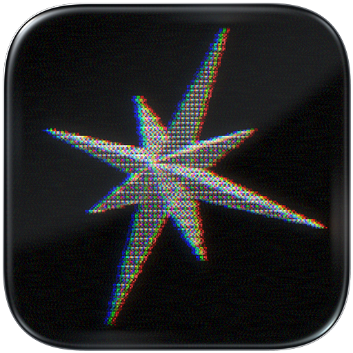

<p align="center">
  <a href="https://glostars.net">
  </a>
  <br>
  
</p>

<h1 align="center">Pen</h1>

<p align="center">
  A code editor that feels like a pen on paper.<br>
  Monochrome ink, a 48pt notebook margin, native GPU text.<br>
  No webview. No telemetry. Offline until you ask otherwise.
</p>

<p align="center">
  <a href="LICENSE"></a>
  <a href="rust-toolchain.toml"></a>
  <a href="#platforms"></a>
  <a href="#privacy"></a>
</p>

<p align="center">
  <a href="https://github.com/anomalyco/rune/commit/d8f89f83e10d99ad65ca525a73b28edcc64fbcb7"></a>
  <a href="https://glostars.net"></a>
</p>

Pen is an open-source editor built in Rust on [Rune](https://github.com/anomalyco/rune): `wgpu` SDF rendering, Parley/Swash text, Taffy layout. It does not embed a browser engine.

---

## Contents

- [Privacy](#privacy)
- [What you get](#what-you-get)
- [Install and run](#install-and-run)
- [Platforms](#platforms)
- [Keyboard](#keyboard)
- [The writing page](#the-writing-page)
- [Settings](#settings)
- [Themes](#themes)
- [Files, Git, and the terminal](#files-git-and-the-terminal)
- [Language servers](#language-servers)
- [Plugins](#plugins)
- [OpenCode](#opencode)
- [Config on disk](#config-on-disk)
- [Speed](#speed)
- [Release size](#release-size)
- [Repository](#repository)
- [License](#license)

---

## Privacy

Pen does not phone home. There is no account, no OAuth, and no telemetry.

Open, edit, save, and find work with the network off. Git fetch, push, and merge connect only when you run them. A GitHub token can be stored in the config directory. Pen does not send it.

---

## What you get

| | |
| :--- | :--- |
| **Home** | Open a folder, start a project, or return to one of sixteen recents. Pin and remove work. |
| **Editor** | Rope buffer, instant caret, IME, find, zoom, and a five-step ink syntax ramp. |
| **Palette** | `⌘K` / `Ctrl+K`. File search is a separate chord. |
| **Settings** | A layer over the window. Close returns to the same file, caret, and sidebar. |
| **Themes** | Ink, Paper, and 48 named palettes. A live preview, then Save. |
| **Git** | Status, diff, stage, commit, checkout, discard, worktrees. Fetch, push, and merge use system `git`. |
| **Terminal** | One panel, your shell, the shell's own colors. Pen's theme does not tint it. |
| **Language server** | Optional. Pen ships none. Diagnostics and go to definition when you configure one. |
| **Plugins** | Optional WASM components. Commands and theme JSON only. No disk, no sockets, no UI. |
| **OpenCode** | Optional side column. Writes ask first. A dirty buffer is never overwritten. |

---

## Install and run

Rust `1.99.1` is pinned by `rust-toolchain.toml`.

```sh
# with just (brew install just)
just run                         # empty page: Open a folder
just run /path/to/folder
just gate                        # fmt, clippy -D warnings, tests, perf budgets

# without just
cargo run --release -p pen
cargo run --release -p pen -- /path/to/folder
```

There is no installer, `.dmg`, or auto-updater. The deliverable is the release binary.

---

## Platforms

| Platform | Targets | You need |
| :--- | :--- | :--- |
| **macOS** | `aarch64-apple-darwin`, `x86_64-apple-darwin` | Xcode Command Line Tools. Metal comes with Rune. |
| **Windows** | `x86_64-pc-windows-msvc`, `aarch64-pc-windows-msvc` | MSVC Build Tools. DirectX 12 via `wgpu`. |
| **Linux** | `x86_64-unknown-linux-gnu`, `aarch64-unknown-linux-gnu` | Build: `libxkbcommon-dev` `libwayland-dev`. Run: `libxkbcommon-x11-0` and a Vulkan driver. |

On macOS, File, Edit, and Window live in the menu bar. On Windows and Linux, File is a menu in the window. Edit and Window stay platform menus.

---

## Keyboard

| Action | macOS | Windows / Linux |
| :--- | :--- | :--- |
| Command palette | `⌘K` | `Ctrl+K` |
| Search project files | `⇧⌘P` | `Ctrl+Shift+P` |
| Open folder | `⌘O` | `Ctrl+O` |
| Save | `⌘S` | `Ctrl+S` |
| Find in file | `⌘F` | `Ctrl+F` |
| Toggle sidebar | `⌘B` | `Ctrl+B` |
| Undo / redo | `⌘Z` / `⇧⌘Z` | `Ctrl+Z` / `Ctrl+Shift+Z` (`Ctrl+Y`) |
| Zoom in / out / reset | `⌘=` / `⌘-` / `⌘0` | `Ctrl+=` / `Ctrl+-` / `Ctrl+0` |
| Toggle comment | `⌘/` | `Ctrl+/` |
| Delete line | `⇧⌘K` | `Ctrl+Shift+K` |
| Move line | `⌥↑` / `⌥↓` | `Alt+Up` / `Alt+Down` |
| Indent / outdent | `⌘]` / `⌘[` | `Ctrl+]` / `Ctrl+[` |
| Terminal | `` ⌘` `` | `` Ctrl+` `` |

Find: `Enter` jumps to the next hit, `Esc` closes the bar. File search filters paths inside the open folder. `Enter` opens one. `Esc` closes the search. It cannot open a path outside the project root.

Typing, the caret, palette open, and Find stay instant. Hover eases in 0.12s. Reduced motion lands at once.

---

## The writing page

The page is a notebook: a 48pt left margin, then right-aligned tabular line numbers, then the text. The caret is a 1.5px ink stroke and moves in the same frame as the key. Surfaces are solid. Rules are 1px ink at 20% alpha. There is no frosted glass and no drop shadow.

Zoom runs from 9pt to 28pt and is not saved. Chrome stays at 13pt. Scale in Settings (90, 100, 120) multiplies the writing-page size on top of zoom. The value is clamped from 90 to 140.

Only the visible lines, plus eight lines of overscan, are shaped or highlighted. Keystrokes do not wait on disk.

Completion sits beside the caret. Arrows move the highlight. `Tab` or `Enter` inserts the selected label. `Esc` closes the list. While it is open, the arrows do not move the caret.

Save writes to a temp file in the same directory and renames it into place. A file that is not UTF-8 is not loaded into the buffer.

---

## Settings

Settings covers the sidebar and the editor. `Esc` and Back dismiss it. The open buffer is not replaced.

| Category | What is there |
| :--- | :--- |
| **General** | Display name and scale. |
| **Customize** | One theme dropdown and a live Rust preview. Save writes the name. Closing without Save leaves the editor's theme alone. |
| **Terminal** | The shells Pen found on `PATH`. Switching restarts only that panel. |
| **Plugins** | Loaded command names, read-only. |
| **Git** | A GitHub token field. Stored. Not sent. |
| **Advanced** | CPU, RAM, disk, and GPU switches. All off until you turn one on. |

An enabled meter that cannot be read says `unavailable`. Pen does not invent a number. GPU stays unavailable unless a counter is already in process.

The first launch shows three lines, once. Grain on the settings page is static.

---

## Themes

Ink and Paper follow the system appearance until you pick one.

| Theme | Ground | Ink |
| :--- | :--- | :--- |
| **Paper** | `#f6f4f0` | `#1a1916` |
| **Ink** | `#12110f` | `#f4f1ea` |

Forty-eight more palettes use word names (Clay, Ochre, Sea, and the rest). A saved name Pen does not know, including an old hue label such as `analogous 0`, falls back to Ink.

A custom theme is a `theme.json` in the config directory:

```json
{
  "name": "Sepia",
  "bg": "#f4efe6",
  "fg": "#1e1b18",
  "accent": "#5b3a29"
}
```

Any `accent`, `syntax`, `added`, `removed`, or `diagnostic` color under 4.5:1 against the ground is dropped and replaced by the OKLab ink ramp. `added` and `removed` tint the diff. They are ink steps, not green and red. A `syntax` list is the only way to add hue to the writing page.

`Use Ink` and `Use Paper` remain in the palette.

---

## Files, Git, and the terminal

The tree starts collapsed. A changed file shows `A`, `M`, `D`, or `U` in ink beside the name, not a colored dot. Untracked files read `new`. Tracked edits read `+n −n` in faint tabular figures.

Git status, history, diffs, staging, commit, checkout, discard, and worktrees run through `gix` on a worker thread. Fetch, push, and merge are the only commands passed to system `git`. Other subcommands, force flags, and force refspecs are rejected before a process starts. If `git` is missing, the status line says `Git is not installed.` and the `gix` views keep working.

Checkout, discard, worktree removal, and merge stop when a buffer is dirty. The status line says `Changed on disk. Your copy is kept.` Discard, worktree removal, and merge also ask in the window before they run.

The terminal is one panel, on the bottom or the side, plus a 28pt control at the bottom-right of the window. It starts `$SHELL` in the open folder, or another shell you pick from the list already on `PATH`. If that shell exits, the panel says `Shell stopped.` and Pen does not start another. If none is installed, it says `No shell found.`

The panel ground is a fixed dark, not the editor theme. Backspace and Delete erase one cell. The screen is 24 by 80 cells and keeps the line you are typing in view. It is not an iTerm or Windows Terminal profile.

Clone is in the File menu and the palette. It uses system `git` into a folder you pick. A failed clone is not opened.

---

## Language servers

Pen ships no language server. With no `lsp.json` next to `theme.json`, no process starts and the caret still moves.

```json
[{ "language": "rust", "command": "rust-analyzer", "args": [] }]
```

A `..` segment in `command` is refused. A relative command is resolved on `PATH` at spawn.

Diagnostics are faint ink underlines on the visible lines of the open file. The message for the caret line is also printed in the status strip. A diagnostic color under 4.5:1 is dropped. The set fades in. Typing does not.

Go to definition is a palette command. A location outside the project root is ignored. No match sets the status line to `No definition.`

If the server exits, the status line says `Language server stopped.` Pen restarts it at most once a minute. A missing binary is reported once and not retried.

The UI thread never waits on the server. Frames are `Content-Length` JSON-RPC over stdio, capped at 8 MB.

---

## Plugins

Plugins are WASM components you place in `plugins/` next to `theme.json`. Pen does not download them.

A plugin may register a command name and a theme JSON string. It cannot read the disk, open a socket, or draw. A command that matches a built-in name is rejected. Theme JSON goes through the same contrast check as `theme.json`. A bad file is skipped and does not replace Ink or Paper. A trap stops that plugin. The editor keeps running.

The default release includes the plugin host. The small build does not:

```sh
cargo build --release -p pen --no-default-features
```

---

## OpenCode

OpenCode is a child process: `opencode acp`, newline-delimited JSON-RPC, method `session/prompt`. If `opencode` is not on `PATH`, the column says `OpenCode is not installed.` and the editor still opens.

The column is a solid 320pt pane. Messages do not animate. Close is on the title row. A write asks `Allow OpenCode to write {path}?` and then uses the atomic writer only when the buffer is clean and you allow it. A dirty buffer stays `Changed on disk. Your copy is kept.` When the child exits, the column says `OpenCode stopped.` Pen does not respawn it.

Claude Code is not a child process. Its file changes arrive through the folder watcher. A dirty buffer is kept.

---

## Config on disk

| Platform | Directory |
| :--- | :--- |
| macOS | `~/Library/Application Support/pen/` |
| Windows | `%APPDATA%\pen\` |
| Linux | `~/.config/pen/` |

| File | Role |
| :--- | :--- |
| `theme.json` | Optional custom theme. |
| `lsp.json` | Optional language servers. |
| `plugins/` | Optional `*.wasm` components. |
| recents, name, token, theme choice | Written by Pen. The token is not sent. |

---

## Speed

Measured on `rustc 1.99.1` against Rune `d8f89f83e10d99ad65ca525a73b28edcc64fbcb7`, 10 MB of UTF-8 Rust, 161,321 lines:

| | Measured | Budget |
| :--- | :--- | :--- |
| Open (`Buffer::from_reader`) | 7.82 ms | < 100 ms |
| Keystroke + 40-line viewport + Rust highlight | 0.111 ms | < 2 ms |

```sh
cargo test --release -p buffer -- --ignored --nocapture
```

Undo keeps 256 inverse edits. Find is a literal scalar search, indexed by character, not byte.

---

## Release size

`cargo build --release -p pen` uses fat LTO, one codegen unit, `opt-level = "z"`, a stripped binary, and `panic = abort`. Plugins stay on.

Measured on Apple silicon, 16 November 2026:

| Build | Bytes |
| :--- | ---: |
| Before those flags | 58,542,992 |
| Release, plugins on | 20,642,608 |
| Release, no plugin host | 17,824,304 |

---

## Repository

| Path | What it is |
| :--- | :--- |
| [`ARCHITECTURE.md`](ARCHITECTURE.md) | Invariants, threads, channels, and the crate graph. |
| [`.interface-design/system.md`](.interface-design/system.md) | Tokens, contrast, and motion. |
| `crates/buffer` | Rope, undo, viewport, find, IME boundary. |
| `crates/highlight` | Ink, Paper, the 48 names, contrast, syntax ramp. |
| `crates/project` | Ignore-aware walk, path-confined UTF-8 read, atomic write, 50 ms watcher. |
| `crates/git` | `gix` for local git. `GitCli` for fetch, push, and merge only. |
| `crates/lsp` | Stdio language-server host. |
| `crates/plugins` | WASM component host. Off in `--no-default-features`. |
| `crates/term` | Shell lookup and the 24×80 screen. |
| `crates/app` | The `pen` binary. |
| `assets/fonts` | IBM Plex Sans and IBM Plex Mono, OFL. See `OFL.txt`. |
| `assets/icons` | `pen.icns`, `pen.ico`, `pen-512.png`, and the file-tree marks. |
| `assets/brand/glostars.png` | The Glostars mark used above. |

The gate, when you want the same check this tree was held to:

```sh
cargo fmt --all -- --check
cargo clippy --all-targets -- -D warnings
cargo test --all-targets
```

---

## License

[MIT](LICENSE). Copyright (c) 2026 AJ.

IBM Plex is under the [SIL Open Font License](assets/fonts/OFL.txt).

Pen is a [Glostars](https://glostars.net) project. The star above is the Glostars mark.
